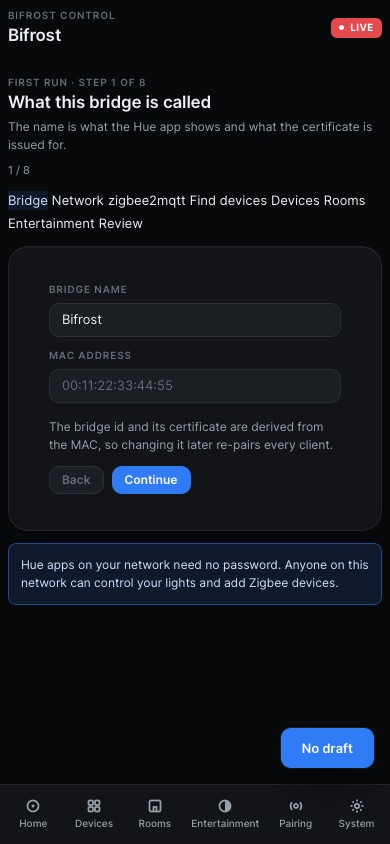
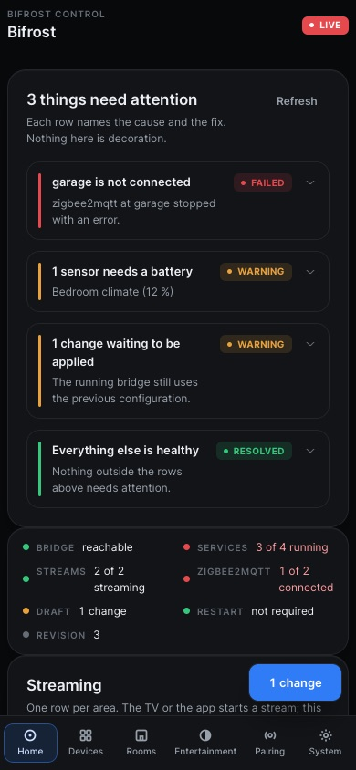
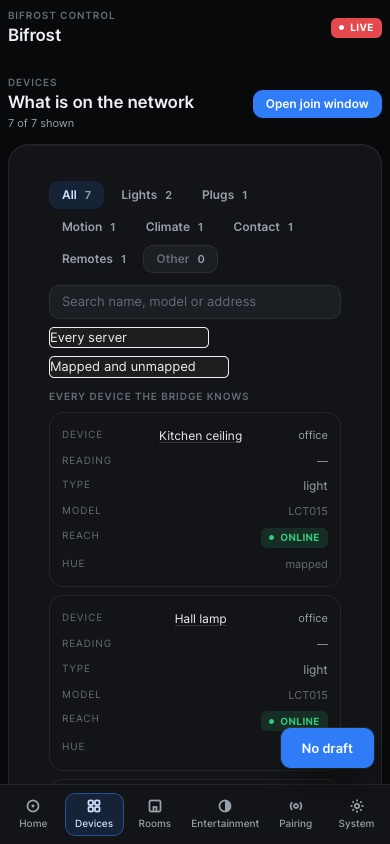
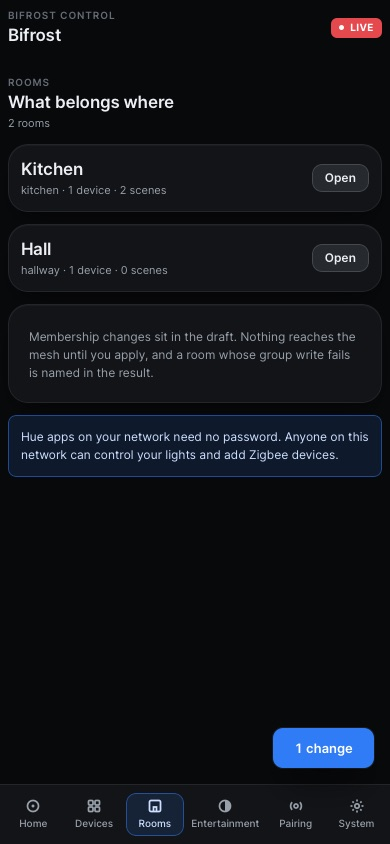
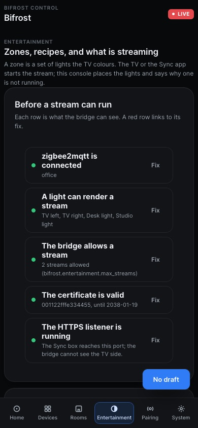
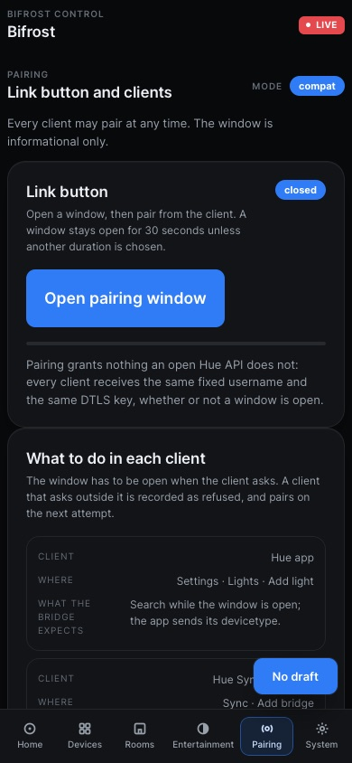
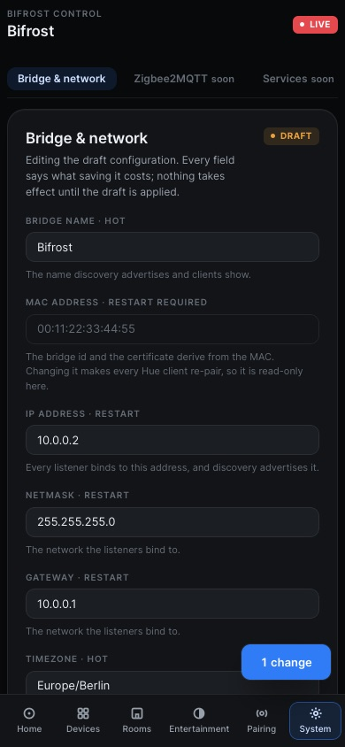

# The Bifrost web interface

Bifrost serves a web interface from `/` on its HTTP and HTTPS ports. It is the
control surface for everything the Hue API cannot express: which zigbee2mqtt
server to talk to, which devices belong in a room, what an entertainment zone
looks like, and why a light is missing from the Hue app.

The interface is built into the binary. Nothing needs installing beside it,
and no separate web server is involved. See
[Configuration reference](config-reference.md#web-ui) for `--ui-dir` and the
path-prefix behaviour behind Home Assistant ingress.

Every screenshot on this page is produced by the end-to-end suite in
`frontend/e2e/docs.spec.ts`, against the same fixture the other browser tests
use. They are not hand-taken, so a screen that stops rendering fails the test
run before its picture goes stale.

## Signing in

The web interface and every endpoint under `/bifrost` need the admin
password. On the first start Bifrost prints a one-time setup code to standard
output; entering it in the browser sets the password. The Hue API needs no
password at all, so a Hue app on the same network keeps working either way.

Sessions are held in a `bifrost_session` cookie and survive a restart. A
session ends after 60 minutes without a request, or 12 hours after login,
whichever comes first. Both are configurable under `bifrost.auth`.

## The screens

The interface is designed for a phone first: 390 px is the width the tests
run at. The bottom bar holds the six destinations, and each screen scrolls
under it.

### Home

Home is a doctor, not a dashboard. It leads with what is wrong, in a fixed
order: critical rows first, then warnings, then one row that says everything
else is healthy. Every row names the cause and opens the fix. A bridge with
nothing wrong shows a single row.

Below the attention list sit the health strip, the running streams, at most
three quick actions, and the draft, when one exists.

### Devices

One table of every device zigbee2mqtt announces, with a tab per device class
and filters over it. A device Bifrost cannot serve still appears, marked
`not mapped`, and its detail names the step that breaks.

The only action on a device is **Identify**, which flashes the light. Pairing
a new device is a server-level action and lives in the screen head, not on a
row.

### Rooms

A room is a zigbee2mqtt group. It is not created here: it arrives when the
group does. The screen decides what belongs to a room and what the room is
called, and both are drafted, never applied directly. Nothing on this page
reaches the mesh until the draft is applied.

### Entertainment

Entertainment holds the zones and the three recipes that create one: a TV
with Ambilight and Hue, a Hue Sync box, and the desktop Hue Sync app. A
preflight sits above the recipes, because it is about the bridge rather than
about a recipe: when it is red, every recipe is blocked for the same reason.

One zone shows where its lights sit on the TV, the channels that makes, and
the stream running on it. Saving writes the positions through the v2 API and
reads the zone back, so the channel table is the server's derivation of what
was saved, not the page's guess. There is no **Start**: a stream begins when
the TV or the Sync app sends its first frame. **Stop** ends it.

At 390 px the position canvas is read-only. Three numbers per segment is not
an edit anyone makes on purpose on a phone.

See [Entertainment](entertainment.md) for the streaming side, and
[Ambilight](ambilight.md) for the TV recipe in detail.

### Pairing

The link button, the window it opens, and who has paired. The mode the bridge
runs in is always on screen, because it decides whether a window matters:

- **compat**, the default, pairs any client at any time, as every Bifrost
  before the interface did.
- **required** pairs only while the window is open.

Either way, pairing grants nothing an open Hue API does not grant: the Hue API
is unauthenticated, and every client shares the same identity. The screen
says so, and so does the notice under it.

### System

System has five tabs. Only **Bridge & network** is built:

| Tab | State |
|---|---|
| Bridge & network | Built. The bridge block of the configuration, and what each field costs. |
| Zigbee2MQTT | Not built. Use [Configuration reference](config-reference.md) and the admin API. |
| Services | Not built. The service list and restart are on the admin API. |
| Logs | Not built. Use `journalctl`, `docker logs`, or the admin API. |
| Maintenance | Not built. Identity backup and restore are on the admin API. |

Bridge & network reads the running configuration and the draft, edits the
bridge block into the draft, and states what each field costs before it is
saved. Nothing on the screen writes the active configuration: Apply, in the
draft bar, does that.

### First run

An unconfigured bridge opens an eight-step wizard: identity, network,
zigbee2mqtt, discovery, lights, rooms, entertainment, review. The password
step comes before all of them, so the session exists by the time the wizard
appears.

Each step records its progress beside the draft rather than in it, so a
half-finished setup is not a set of unapplied edits and discarding a draft
cannot throw setup away. The draft is written once, at review.

## The draft

Nothing is applied by clicking. Edits go into a draft, the draft is validated
and diffed, and Apply writes it. The draft survives a restart in
`config.draft.yaml` next to `config.yaml`, and applying leaves the previous
file as `config.yaml.bak`.

Every write names the revision it was based on, so two browsers editing at
once cannot silently overwrite each other. The admin API documents the same
contract, below.

## The admin API

Everything the interface does, it does through this API. It is the supported
way to script Bifrost.

Every endpoint below requires the admin login. `/bifrost` sends no CORS
headers: only the Hue routes (`/api`, `/clip`, `/eventstream`, `/auth`,
`/updater`, `/licenses`, `/description.xml`) stay open to every origin.

| Endpoint | Purpose |
|---|---|
| `GET /bifrost/auth/session` | `{authenticated, setup_required, ingress, csrf}` for the current request. |
| `POST /bifrost/auth/setup` | Set the first password: `{"setup_code": "...", "password": "..."}`. |
| `POST /bifrost/auth/login` | `{"password": "..."}`; sets the session cookie. |
| `POST /bifrost/auth/logout` | End this session, or every session with `{"all": true}`. |
| `POST /bifrost/auth/password` | `{"current_password": "...", "new_password": "..."}`. |
| `GET /bifrost/config` | Active configuration, with secrets redacted. |
| `GET /bifrost/config/draft` | Current revision and the draft, if any. |
| `PUT /bifrost/config/draft` | Replace the draft: `{"revision": n, "config": {...}}`. |
| `PATCH /bifrost/config/draft` | Change the draft with a JSON merge patch: `{"revision": n, "patch": {...}}`. |
| `DELETE /bifrost/config/draft` | Discard the draft: `{"revision": n}`. |
| `GET /bifrost/config/diff` | Settings that differ between the active configuration and the draft. |
| `GET /bifrost/config/validate` | Findings for the draft, or for the active configuration without one. |
| `POST /bifrost/config/validate` | Findings for the configuration in the request body. |
| `POST /bifrost/config/apply` | Apply the draft: `{"revision": n}`. Returns the apply plan. |
| `POST /bifrost/config/restart` | Apply the draft (if any, naming its revision), then exit so the supervisor restarts Bifrost. |
| `GET /bifrost/config/export` | Active configuration as YAML, with secrets redacted. |
| `POST /bifrost/config/import` | Replace the draft from YAML: `{"revision": n, "yaml": "..."}`. |
| `GET /bifrost/devices` | Every device on every zigbee2mqtt server, with what Bifrost can serve. |
| `GET /bifrost/devices/{ieee}` | One device, by IEEE address. |
| `POST /bifrost/devices/{ieee}/identify` | Flash the device, so a person can see which one it is. |
| `GET /bifrost/rooms` | The rooms, with their members and scenes. |
| `POST /bifrost/rooms/{room}/scenes/{scene}/recall` | Recall one of the room's scenes. |
| `GET /bifrost/entertainment/capabilities` | What this bridge can stream, and how many streams at once. |
| `GET /bifrost/entertainment/status` | The streams running now, with their rates and counters. |
| `GET /bifrost/entertainment/configurations/{id}` | One entertainment zone, with its channels. |
| `POST /bifrost/entertainment/{id}/stop` | Stop the stream on one zone. |
| `GET /bifrost/z2m` | The configured zigbee2mqtt servers and their state. |
| `GET /bifrost/bridge/link-button` | Whether the pairing window is open, and when it closes. |
| `POST /bifrost/bridge/link-button` | Open the pairing window. |
| `GET /bifrost/bridge/pairing` | The clients that have paired, and the pairing mode. |
| `GET /bifrost/bridge/certificate` | The bridge certificate: subject, validity, serial, SHA-256 fingerprint. |
| `POST /bifrost/bridge/certificate/regenerate` | Replace the certificate. Every paired client must pair again. |
| `POST /bifrost/bridge/identity/mac` | Change the bridge MAC address. |
| `GET /bifrost/bridge/identity/backup` | The identity archive, for restoring the bridge elsewhere. |
| `POST /bifrost/bridge/identity/restore` | Restore an identity archive. |
| `GET /bifrost/service` | The listeners the bridge runs, and their state. |
| `PUT /bifrost/service/{id}` | Start or stop one service. |
| `POST /bifrost/service/{id}/restart` | Restart one service. |
| `GET /bifrost/state/summary` | What the state file holds: resources, users, scenes. |
| `GET /bifrost/state/export` | The state file as a download. |
| `POST /bifrost/state/reset` | Replace the state with an empty one. Every paired client must pair again. |
| `GET /bifrost/logs` | The recent log lines the bridge kept in memory. |
| `GET /bifrost/setup/wizard` | The first-run wizard's recorded progress. |
| `PUT /bifrost/setup/wizard` | Record the wizard's progress. |
| `POST /bifrost/setup/discovery` | Ask one zigbee2mqtt server what devices it has. |
| `GET /bifrost/ws` | The live event socket. |

### Setup mode

When the configuration file is missing or cannot be read, Bifrost serves a
smaller surface on its setup listener, and only there:

| Endpoint | Purpose |
|---|---|
| `GET /bifrost/setup/status` | The configuration file, why it could not be used, and whether `config.yaml.bak` exists. |
| `POST /bifrost/setup/restore` | Load `config.yaml.bak` into the draft: `{"revision": n}`. |
| `GET /bifrost/setup/wizard` | The first-run wizard's recorded progress. |
| `PUT /bifrost/setup/wizard` | Record the wizard's progress. |
| `POST /bifrost/setup/discovery` | Ask one zigbee2mqtt server what devices it has. |
| `GET /bifrost/config/draft` | The draft, which may be incomplete. |
| `PUT /bifrost/config/draft` | Replace the draft. |
| `PATCH /bifrost/config/draft` | Change the draft with a JSON merge patch. |
| `DELETE /bifrost/config/draft` | Discard the draft. |
| `GET /bifrost/config/validate` | Findings for the draft. |
| `POST /bifrost/config/validate` | Findings for the configuration in the request body. |
| `POST /bifrost/config/import` | Replace the draft from YAML. |
| `POST /bifrost/config/apply` | Write the draft, with the new password, and start the bridge. |

Nothing else answers in setup mode: no device list, no services, no logs, no
state. `scripts/doc-check.sh` walks every endpoint documented on this page
and asserts it answers, so a table that drifts from the router fails the gate
instead of misleading a reader.
